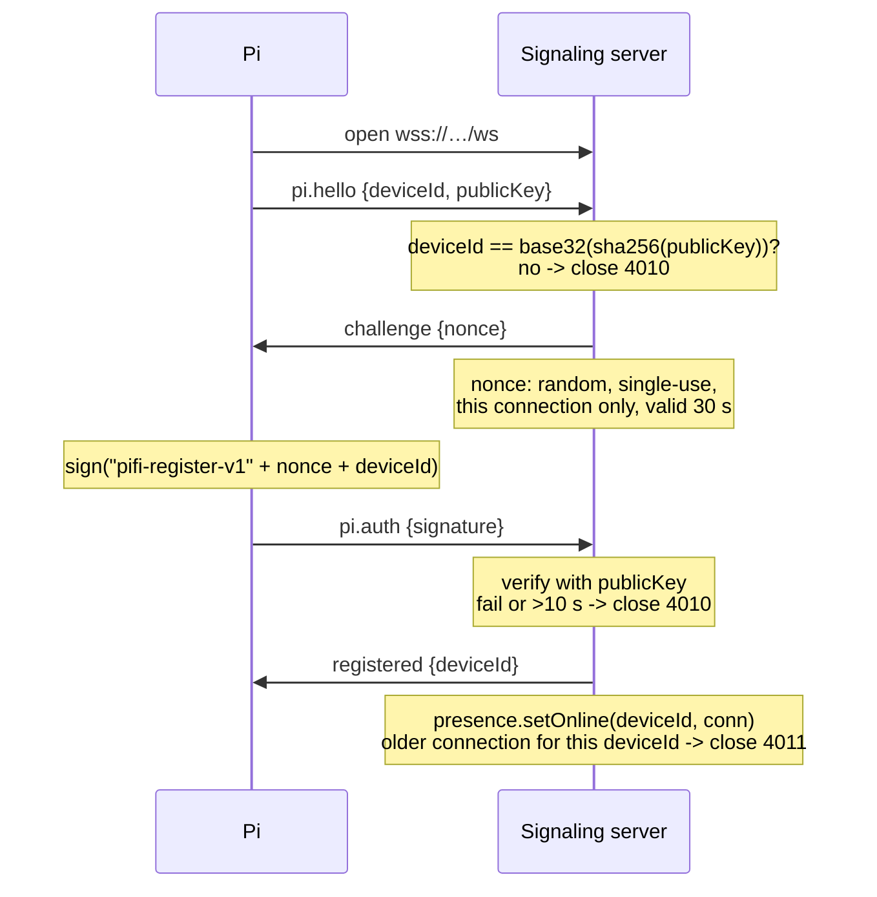
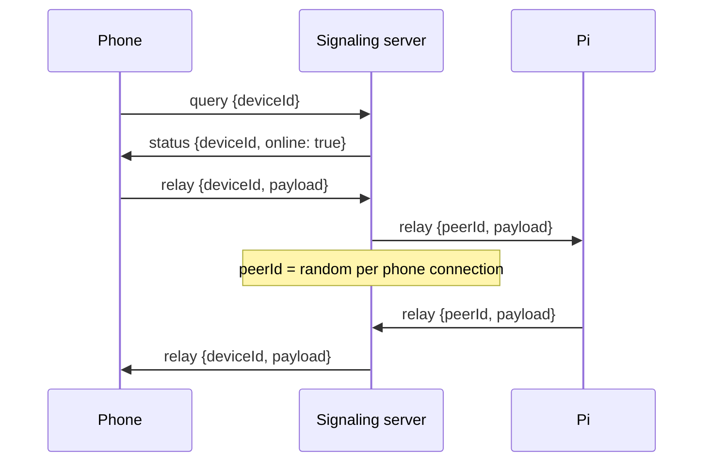

# Signaling (Phase 2)

The signaling server introduces phones to Pis. It is deliberately small and
**untrusted**: it relays opaque messages and tracks who is online. It holds no
secrets, no files, no accounts and no database, and it has **no way to start
or stop apps**. App control comes later, over the phone↔Pi peer-to-peer channel,
after the Pi has authenticated the phone itself (Phase 3).

```
 Pi ──(outbound wss, stays open)──► signaling server ◄──(wss)── phone
          "I am online"                 presence +              anonymous
                                        opaque relay
```

The Pi never opens an inbound port. It dials out and keeps that one socket open.

## Trust rules

- The server never parses relay payloads (they are base64url blobs to it).
- A Pi counts as online only after proving it holds the private key behind its deviceId.
- Phones do not authenticate to the server; the server doesn't know phones as identities.
- Logs never contain payloads, secrets, signatures, nonces, keys or full IPs;
  deviceIds appear only as their first 8 characters, IPs masked (`203.0.x.x`).

## Identity and deviceId

Each Pi has an ECDSA P-256 keypair (`${PIFI_HOME}/keys/`). Its public name is:

```
deviceId = lowercase base32 (RFC 4648, no padding) of SHA-256(SPKI DER of the public key)
```

52 characters, alphabet `a-z2-7`. A browser reproduces it with
`crypto.subtle.exportKey('spki', key)` → `crypto.subtle.digest('SHA-256', …)` → base32.
The server never takes a deviceId on trust; it recomputes it from the key.

## Registration handshake



Signed bytes, exactly: `UTF-8("pifi-register-v1") || UTF-8(nonce as sent) || UTF-8(deviceId)`
(16 + 43 + 52 bytes). Signature: ECDSA P-256, SHA-256, IEEE P1363 (raw `r||s`,
64 bytes), base64url. Because the nonce comes from the server and lives only in
that one connection, a recorded handshake can't be replayed. No clocks are compared.

## A phone talking to a Pi



A phone connection is bound to the first deviceId it names (`target-mismatch` otherwise),
so one socket can't fan out to many Pis. A Pi can only answer phones currently talking to it.
No endpoint lists Pis; `query` only answers for an exact deviceId.

## Messages

Every frame: `{ "v": 1, "type": "…", … }`, JSON text. Anything unknown or invalid closes with 4013.
The **first** valid message fixes the connection's role: `pi.hello` → Pi; `query`/`relay` → phone.

| Direction | type | fields |
|---|---|---|
| Pi → server | `pi.hello` | `deviceId`, `publicKey` (SPKI DER, base64url) |
| Pi → server | `pi.auth` | `signature` (P1363, base64url) |
| Pi → server | `relay` | `peerId`, `payload` |
| phone → server | `query` | `deviceId` |
| phone → server | `relay` | `deviceId`, `payload` |
| server → Pi | `challenge` | `nonce` |
| server → Pi | `registered` | `deviceId` |
| server → Pi | `relay` | `peerId`, `payload` |
| server → phone | `status` | `deviceId`, `online` |
| server → phone | `relay` | `deviceId`, `payload` |
| server → either | `error` | `code`, `message` |

Error codes: `target-offline`, `peer-gone`, `payload-too-large`, `target-mismatch`.
Limits: frame ≤ 16 KiB (larger frames are closed by `ws` with **1009**), relay
`payload` ≤ 15 KiB of base64url (larger gets `payload-too-large`, connection stays open).

## Close codes

| code | meaning | Pi client reaction |
|---|---|---|
| 4010 | registration failed (bad deviceId, bad signature, timeout) | log an error, retry at max backoff |
| 4011 | replaced by a newer connection for the same deviceId | wait ≥ 30 s; give up after 3 in a row (two devices with one identity?) |
| 4012 | rate limited | normal backoff |
| 4013 | protocol violation | normal backoff |
| 4100 | server restarting | reconnect after a random 0–3 s |
| other | network drop etc. | exponential backoff 1 s → 30 s, ±20% jitter; resets after 60 s online |

They don't collide with the app-socket codes 4001–4005.

## Keepalive and limits

- Server pings every connection every 30 s; one that didn't answer the previous ping is terminated (and the Pi marked offline).
- The Pi also pings every 25 s and drops a server that stops answering.
- Per IP: 30 new connections/minute; 5 failed Pi registrations/minute, then that IP is
  refused registration for 5 minutes; at most `MAX_PHONES_PER_IP` (20) phone connections.
- Per connection: 20 messages burst, 5/s sustained. Exceeding any limit closes with 4012.
- IPs exist only in these in-memory counters and are swept when idle.

## Hardening (Phase 3 Part A)

| Rule | Default | Env |
|---|---|---|
| A connection must send its first message (`pi.hello` / `query` / `relay`) in time, or it is closed with 4013 | 10 s | `FIRST_MESSAGE_TIMEOUT_MS` |
| A phone whose first `query` finds the Pi offline gets the `status`, then a `1000` close; a first `relay` to an offline Pi gets `target-offline`, then a close. (The shell retries with a new connection every ≥ 5 s.) | | |
| A phone connection with no message for this long is closed | 120 s | `PHONE_IDLE_TIMEOUT_MS` |
| Total sockets; over the cap, new upgrades get HTTP 503 | 800 | `MAX_CONNECTIONS` |
| Phone sockets; kept below the total so phones can't crowd out Pis | 600 | `MAX_PHONE_CONNECTIONS` |
| Pi connections per IP | 5 | `MAX_PIS_PER_IP` |

All per-IP limits (connection rate, phones, Pis, registration failures) key
**IPv6 addresses by their /64** (one home or phone usually owns a whole /64);
IPv4 stays per address. Logs still show masked IPs only.

### Abuse model

Anyone can generate a valid P-256 key in milliseconds, so "only real Pis may
register" is not enforceable: a registration only proves possession of *some*
key, and a deviceId is just its hash. There is no allowlist, and there can't be
one without accounts. The defence is **caps and short lifetimes**: per-IP and
global connection caps, a reserved share of slots for Pis, first-message and
idle timeouts, rate limits, and closing phones that have nothing to talk to.
An attacker can still use their share of the capacity; they can't take
everyone's, and they can't impersonate a real Pi (that needs its private key).

## Running it locally

```bash
npm run build
PORT=8080 npm run signal-server                                # terminal 1
PIFI_DEV=1 PIFI_SIGNAL_URL=ws://localhost:8080/ws pifi daemon   # terminal 2
pifi status                                                    # signaling  online ...
npm run -s signal-testclient -- status <deviceId> --url ws://localhost:8080/ws
npm run -s signal-testclient -- echo <deviceId> --url ws://localhost:8080/ws --data hello
```

`echo` only gets an answer with `PIFI_DEV=1`. Since Phase 3 the Pi also answers
pairing and session handshakes over the relay: see [wire-protocol.md](wire-protocol.md).
