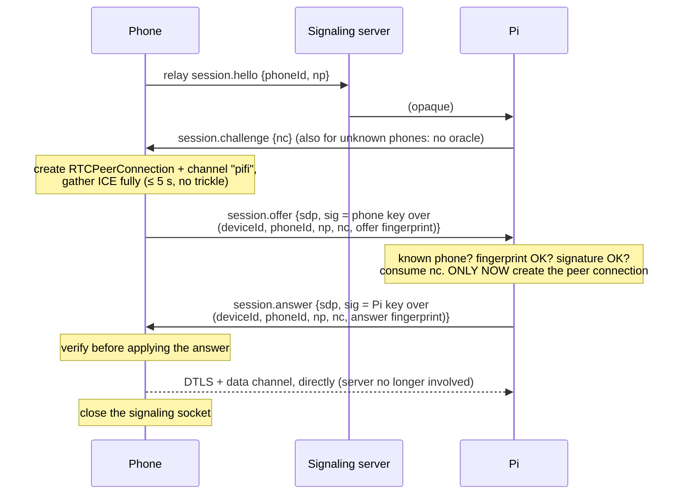

# Phone ↔ Pi protocol (Phase 3)

Three layers, from the outside in:

1. **Relay bodies**: JSON the phone and the Pi exchange *through* the signaling
   server, to pair and to set up a session. The server only sees base64url text.
2. **The WebRTC data channel**: one reliable, ordered channel labelled `pifi`,
   direct between phone and Pi, authenticated by the session handshake.
3. **The app frame port**: a `MessagePort` between the shell and an app's page
   (see [app-frontends.md](app-frontends.md)).

All schemas live in `packages/protocol/src` (`relay.ts`, `wire.ts`, `port.ts`,
`signed.ts`) and are shared by the Pi and the shell.

## Identifiers and signatures

- `deviceId` (Pi) and `phoneId` (phone) = lowercase base32 (no padding) of
  SHA-256 of the SPKI DER public key. 52 characters.
- Keys: ECDSA P-256. Signatures: IEEE P1363 (raw `r||s`, 64 bytes), base64url.
- **One phone key per Pi**, so two Pis can't tell they were paired with the same phone.
- `signedMessage(context, ...parts)` = `utf8(context)` then, per part, a 4-byte
  big-endian length and the bytes. Contexts: `pifi-pair-accept-v1`,
  `pifi-session-phone-v1`, `pifi-session-pi-v1`.
- `fingerprintBytes(sdp)`: the 32 raw bytes of the DTLS certificate fingerprint.
  Requires at least one `a=fingerprint:` line, all `sha-256`, all identical;
  anything else rejects the SDP.
- Test vectors (computed with Python/OpenSSL, not with PiFi code):
  `packages/protocol/test/vectors.json`, checked by both Node and WebCrypto tests.

## Relay bodies

Each body is `base64url(utf8(JSON))` in a relay `payload`, under 12 KiB, with a `k` (kind).

| k | direction | fields |
|---|---|---|
| `pair.request` | phone → Pi | `phoneSpki`, `proof`, `challenge` (16 bytes), `label` (≤ 40) |
| `pair.accept` | Pi → phone | `piSpki`, `signature` |
| `pair.reject` | Pi → phone | `reason: "rejected"` (always the same body, whatever went wrong) |
| `session.hello` | phone → Pi | `phoneId`, `np` (≥ 16 random bytes) |
| `session.challenge` | Pi → phone | `nc` (16 random bytes) |
| `session.offer` | phone → Pi | `sdp`, `sig` |
| `session.answer` | Pi → phone | `sdp`, `sig` |
| `session.reject` | Pi → phone | `reason: "rejected"` |

### Pairing (once per phone per Pi)

```mermaid
sequenceDiagram
    participant P as Phone (shell /pair page)
    participant S as Signaling server
    participant Pi
    Note over P: read #id=deviceId&s=secret, erase it from the URL at once
    P->>S: query deviceId (retry every 5 s for 60 s while offline)
    Note over P: new non-extractable P-256 key for THIS Pi
    P->>S: relay pair.request {phoneSpki, proof, challenge, label}
    S->>Pi: (opaque)
    Note over Pi: proof == HMAC-SHA256(secret, "pifi-pair-v1"||deviceId||phoneSpki)?<br/>constant time; 5 failures burn the code; success burns it too
    Pi->>S: pair.accept {piSpki, signature}
    S->>P: (opaque)
    Note over P: base32(sha256(piSpki)) == deviceId from the QR?<br/>signature over ("pifi-pair-accept-v1", deviceId, phoneSpki, challenge) valid?<br/>only then store the key
```

The HMAC key is the secret's 16 raw bytes (base64url-decoded `s`). The secret itself never travels.

### Session setup (every connection)



**Why this is safe against a malicious signaling server:** each side signs the
DTLS fingerprint it will use. WebRTC only completes DTLS if the peer's
certificate matches the fingerprint in the SDP it was given. A server that swaps
SDPs therefore can't get either side to connect to it. ICE candidates aren't
signed, and don't need to be: relaying the packets would only show DTLS ciphertext.

Pi-side rules: challenges are single-use, 30 s, bound to the relay `peerId`;
at most 32 outstanding (1 per peer); 5 handshake attempts per peer per minute;
`PIFI_MAX_SESSIONS` (5) live sessions; a new session for the same phone closes
the old one; revoking a phone closes its session immediately.

## Data channel frames (v1)

Text frames are JSON, at most 64 KiB, strictly validated. Anything malformed,
unknown or unexpected closes the session.

| frame | direction | meaning |
|---|---|---|
| `{t:"req", id, app?, op, payload}` | phone → Pi | no `app`: control op; with `app`: to that app |
| `{t:"res", id, ok:true, payload}` / `{t:"res", id, ok:false, error:{code,message}}` | Pi → phone | reply |
| `{t:"evt", app, name, data}` | Pi → phone | app event (only to sessions that sent `sub`) |
| `{t:"sub", app}` / `{t:"unsub", app}` | phone → Pi | event subscription |
| `{t:"ping", n}` / `{t:"pong", n}` | both | heartbeat |
| `{t:"s.open", sid, app, op, meta}` | either | open a stream (phone: odd sids, Pi: even) |
| `{t:"s.ok", sid}` / `{t:"s.reject", sid, error}` | either | answer to `s.open` |
| `{t:"s.end", sid}` | either | **half-close**: "I'm done sending" |
| `{t:"s.abort", sid, reason}` | either | stream failed |

Binary frames carry stream data: `[u32 big-endian sid][chunk]`, chunk ≤ 16 KiB.

### Control ops (no `app`; only the shell can send them)

| op | payload | result |
|---|---|---|
| `status` | | `{deviceId, deviceName, version, memoryAvailableMB, runningApps}` |
| `apps.list` | | `[{name, version, description, displayName, state, frontend}]` |
| `apps.start` / `apps.stop` / `apps.restart` | `{name}` | `{state}` |
| `phones.list` | | `[{phoneId, label, createdAt, lastSeenAt, connected, current}]` |
| `phones.revoke` | `{phoneId}` | `{}` (revoking yourself: reply first, then the session closes) |

Error codes: `BAD_REQUEST`, `NOT_FOUND`, `APP_NOT_RUNNING`, `TIMEOUT`, `BUSY`,
`START_FAILED`, `INTERNAL`, plus whatever code an app itself returns.

### App requests

A `req` with `app` becomes the app's Phase 1 `request` with
`payload = {op, payload}` and an extra `session` field (opaque; lets the app
open a stream back). 30 s timeout → `TIMEOUT`.

### Limits

| | |
|---|---|
| Text frame | 64 KiB; ~100/s sustained, 200 burst, per session |
| In-flight requests | 64 per session |
| Open streams | 16 per session; 8 per app |
| Stream chunk | 16 KiB |
| Backpressure | stop sending above 1 MiB `bufferedAmount`; resume on `bufferedamountlow` at 256 KiB |
| Heartbeat | phone pings every 15 s; 2 missed pongs = dead; Pi closes after `PIFI_SESSION_IDLE_SEC` (45) of silence |
| Stream idle | 30 s without data on the app side |

Backpressure Pi → phone: when the channel is backed up, PiFi pauses reading that
app's localhost socket, so TCP pushes back on the app (`await stream.write()`
in the SDK waits). Phone → app: if an app stops reading, the stream is aborted
rather than buffered without limit.
